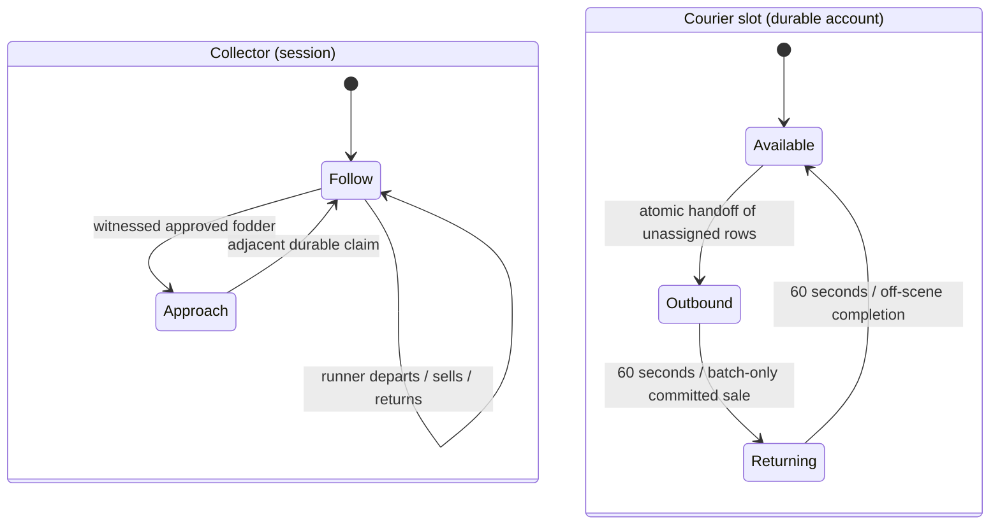

# Collector and courier redesign

## Audit and persistence

Previously the one actor disappeared throughout account states 1/2, and `prepare`
rejected claims in those states. `settle` consumed every unsold row. This made
continuous collection impossible without a durable batch boundary.

Schema v2 (`migrations/002_broker_courier.sql`, after 001, server stopped) adds an
immutable nullable `escrow.trip` and two account notification flags. Under the
existing exclusive DB lease and account row lock, handoff assigns only unassigned
rows and updates the one active courier slot in one transaction. New field claims
remain unassigned. Settlement consumes only that trip. Reusing a handoff key,
including after return, cannot assign new items. No second item image is created
at handoff. Existing v1 outbound batches are backfilled without changing their
deadlines, prices, balances or settlement identities. Historical notices are muted.
The server requires schema v2 only when the broker is enabled.

A departure/sale notification is durably claimed before sending, after confirmed
financial commits. This gives **at-most-once emission**, including after a lost
commit acknowledgement or restart. Atomic exactly-once delivery to an unmodified
Tibia client is impossible: a crash between the notification commit and socket
send may omit the summary. `!broker balance` and the immutable sale ledger remain
authoritative. No notice is emitted for an uncommitted sale.

## Missed brass helmet

`easyloot.cpp` originally stored spilled ground witnesses inside `CorpseEntry`.
`valid()` expired that entry 300,000 ms after generation; inserting the 1,025th
corpse also evicted the oldest entry. `brokerCandidates()` only consulted these
entries, so an untouched helmet could never qualify again after retirement.
Visibility exit itself did not invalidate a witness. Separately, the old collector
paused hiring when it fell outside its leash or changed floor. These are distinct
coverage failures; neither justifies scanning arbitrary ground items.

Foundation validation: full native suite 29/29, including rollback/lost handoff
acknowledgement, key reuse, continued field claims, batch-only sale and notice replay.

## Qualified fodder lifetime

Exact, already-spilled, priced `BrokerFodder` now has an independent registry of
at most 8,192 item witnesses, each retaining the original item and source corpse.
There is no visibility or age timeout. The five-minute/1,024-entry currency and
unspilled-loot snapshot bounds remain unchanged. A genuine witness-cap overflow
retires the oldest witness; it never rescans generic ground items. Server restart
still clears transient world witnesses (and transient generated ground loot).
Source corpse move/removal/transform, item move/merge/transform, identity/count
change or newly unsafe item state/handler retires eligibility. The original source
corpse relationship and safe pickup tile remain required. References protect
against pointer reuse; neither leaving visibility nor corpse-snapshot eviction
loses an otherwise valid witness. The regression leaves visibility, advances past
five minutes, exceeds the old corpse bound, returns, and claims the real brass
helmet once; moving another helmet away and back still invalidates it.

Witness validation: full native suite 30/30, including the real-engine visibility/TTL/eviction and manual-mutation regression.

## Actor and batch model

Both actors use NPC look 69, are noncombatants, consume no summon slots and use
the existing safe placement/body/path rules. The collector is the only actor
passed to pickup/approach logic. The runner appears safely adjacent to the
collector for a two-second handoff, says `Pickup!`, then `Off to town!` and
disappears for represented travel. It has no independent loot search or pickup.
Return completes off-scene; there is no teleport, duplicate collector or forced
placement. If no safe handoff placement exists, dispatch waits with escrow intact.
A restarted trip resumes off-scene instead of spawning a second runner.

The collector holds up to 20 unassigned whole instances, while one active courier
batch holds up to 20. They share one inaccessible 40-slot backing container; the
immutable SQL assignment defines ownership. Handoff neither copies nor recreates
instances. New field rows never join the existing trip. Recovery creates each
unsold image once only when no real live instance/quarantined original exists.
Settlement consumes only confirmed sold instances. At full field capacity during
a trip, additional loot stays on the ground until capacity becomes available.

Automatic dispatch uses fixed centralized defaults in `broker.h`:

- Full 20-instance field batch: immediately on the next decision tick.
- Otherwise: at least 10 instances, at least 250 gp gross, and at least 120 seconds
  since the last pickup. All three conditions are required.
- `!broker sell`: any nonempty field batch, with no active trip, hired collector
  and safe runner placement. An existing trip is never replaced or duplicated.

One cheap hatchet never causes an idle automatic trip. These are bounded policy
constants, not new configuration keys. Existing commission configuration applies
unchanged. Durable travel remains 60 seconds outbound plus 60 seconds return.

## Messages and hire

Pickups remain floating `TALKTYPE_MONSTER_SAY` only, once per successful field pickup:
`Got a hatchet.` Runner captions use the same classic mode. Operational summaries
use `MESSAGE_STATUS_DEFAULT` (0x15, white bottom text **and console**), unlike
`MESSAGE_STATUS_SMALL` (0x17, bottom text only). No new opcode is introduced.

- `Broker runner left for town with <count> items (estimated <gross> gp).`
- `Broker sale complete: <gross> gp gross. Your share: <net> gp. Broker fund: <fee> gp.`
- `Broker is with you. Carrying <instances>/20 items.`
- When traveling, append `Runner is in town with <count> items.` or
  `Runner is returning after delivering <count> items.`
- When pending is nonzero, append `Broker has <pending> gp waiting for cashout.`
- An already active trip answers explicit sell with
  `Broker runner is already on a trip. Field collection continues.`

Repeated `!broker hire` reports operational status without replacing actors,
resetting idle timers or resetting a trip. Hiring resumes paused collection
safely. Balance also shows the retained fund; cashout keeps the original atomic
bank-payout path. Dismiss/logout/death remove both visible actors without losing
escrow, trips or balances. Travel can reconcile on a later command/session.

Collector/courier validation: full native suite 30/30, including six real engine
processes for prepare, handoff, travel, sale, payout and final restart, independent
field claims, batch-only settlement, original wire feedback and repeated hire.

## Floor presentation

`Player::onCreatureMove` notifies `Broker::ownerMoved` only for the owner's floor
change. It immediately removes collector/scene runner, clears approach, and
sets a session-only 1,500 ms stable-floor delay. Every subsequent floor change
resets it. The normal one-second decision tick rechecks the same GUID/session,
alive/hired state, DB/escrow validity and safe adjacent placement. Typical
reappearance is 1.5–2.5 seconds depending on tick phase; blocked placement waits
rather than forcing or visibly teleporting an actor. No stair/rope/hole pathfinding
is added. `!broker hire` reports `Broker is paused after a floor change. Rejoining
shortly.` during this delay and cannot bypass it. Courier travel and all durable
ownership/balances remain unchanged; a scene courier removed by a floor change
continues its already assigned trip off-scene. New claims require the physically
present same-floor collector. Reconciliation may finish ownership already prepared
before a pause; it never qualifies new cross-floor loot.

Far same-floor travel beyond the leash still pauses collection until explicit
hire. Logout, death or dismiss cancels delayed presentation. There is no scheduled
callback holding a player pointer: a mismatched/stopped session cannot reappear.
The `engine_broker_floor` test covers resets, blocked placement, hire during delay,
active courier batch preservation, no absent/cross-floor claims, local collection
after rejoin and death before reappearance. Full native suite: 31/31 passed.

## Source map and verification

| Responsibility | Source |
| --- | --- |
| Session roles, follow/claim, batching, handoff, status and notices | `src/broker.cpp`: Context, hydrate, claim, dispatch, notices, tick, command |
| Locked batch assignment, batch-only sale, durable notice claim | `src/brokerstore.cpp`: prepare, depart, settle, claimNotice; schema v2 in migration 002 |
| Exact fodder witness independent of snapshot TTL/eviction | `src/easyloot.cpp`: FodderWitness, prune, onLootItemMove, brokerCandidates |
| Native dwarf construction and runner dialogue isolation | `src/npc.cpp`: Npc::createBroker, onCreatureSay |
| Immediate floor pause and guarded rejoin | `src/player.cpp`: Player::onCreatureMove; Broker::ownerMoved/tick |

Final local validation: **33/33 normal**, **33/33 AddressSanitizer + UndefinedBehaviorSanitizer**,
including the real MariaDB fixture, six-process restart sequence, snapshot
visibility regression, field capacity during travel, runner noncollection,
explicit/automatic dispatch and wire-level notice replay/failure checks.
ASan uses `detect_leaks=0` for existing process-lifetime engine fixtures; UBSan
uses `halt_on_error=1`. Leak detection is not claimed. All 81 compile commands
are free of cotire/prefix/PCH paths. GitHub's Ubuntu 24.04 matrix runs both
`USE_LUAJIT=ON` and `OFF`, including the full suite and the migration fixture.

`tests/migrate_broker_fixture.py` exercises **the actual migration SQL** with
legacy outbound/returning accounts, verifies exact claim identity, batch binding,
original deadlines, pending/fund totals, sale values and muted historical notices,
then removes only its disposable fixture rows. It ran successfully locally using
the container's MariaDB client. CI runs it before the gameplay suite. Never use
this fixture helper or the base SQL import on a live database.

No new configuration options, Action IDs, item identities, prices, market buying
or fund-spending behavior are added in this redesign. Existing reserved IDs and
all catalog/state/handler/provenance protections remain unchanged. Original-client
presentation and real hunting-route feel require the manual checklist in
[BROKER_TEST_CHECKLIST.md](BROKER_TEST_CHECKLIST.md).
